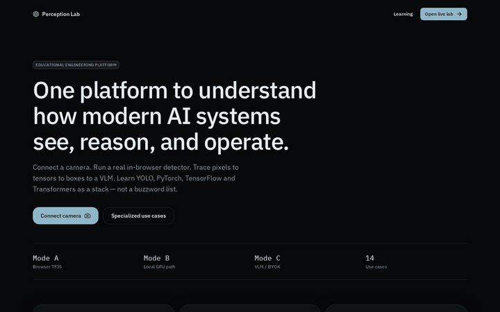
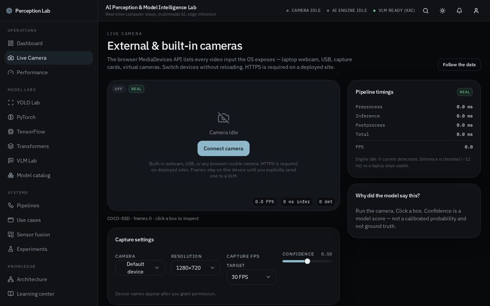
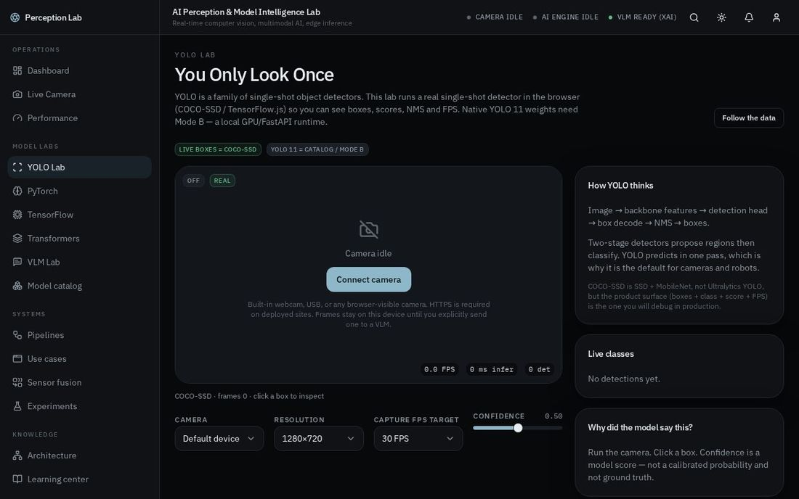
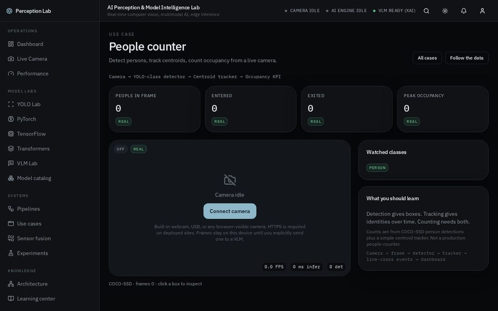
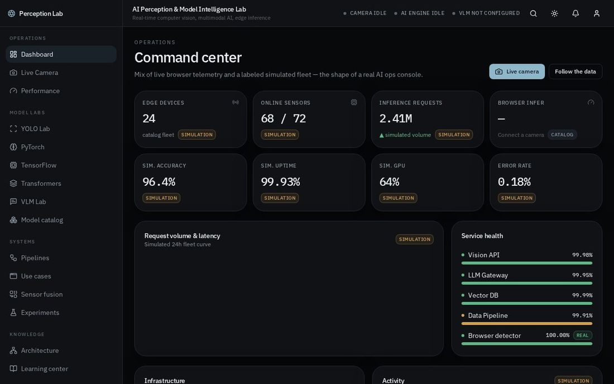
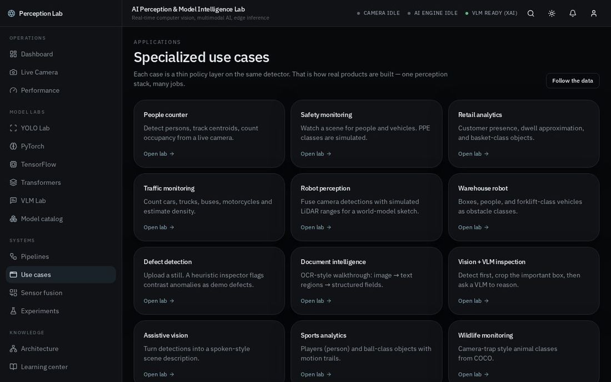
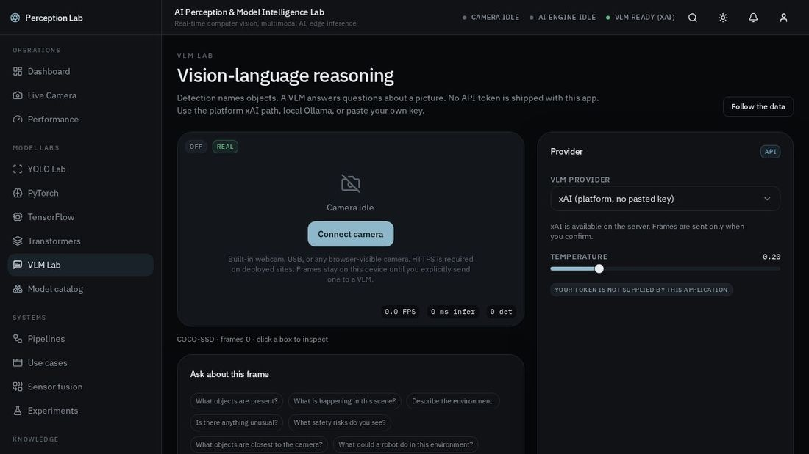

# AI Perception & Model Intelligence Lab

Real-time computer vision, multimodal AI, edge inference and model operations — in one educational platform.

A portfolio / learning lab for engineers working at the intersection of computer vision, robotics, PyTorch, TensorFlow, Transformers and VLMs. It is designed to feel like an internal operations console, not a toy dashboard.

Live camera frames stay on the device until you explicitly send one to a vision-language model.

<p align="center">
  
</p>

<p align="center">
  <b>Landing → Dashboard → Live camera → YOLO lab → People counter → VLM lab</b>
</p>

## Demo

| Live camera | YOLO lab | People counter |
| --- | --- | --- |
|  |  |  |

| Ops dashboard | Use cases | VLM lab |
| --- | --- | --- |
|  |  |  |

A 10-second silent MP4 of the same tour lives at [`docs/demo/perception-lab.mp4`](docs/demo/perception-lab.mp4).

## What this project is

A single web application where you can:

1. Connect a laptop webcam or external USB camera
2. Run a **real** in-browser object detector (TensorFlow.js COCO-SSD)
3. Inspect boxes, confidence, FPS and a centroid tracker
4. Walk specialized use cases (people counting, safety, traffic, robotics, …)
5. Ask a VLM about a captured frame (xAI, local Ollama, or BYOK)
6. Learn how YOLO, PyTorch, TensorFlow, Transformers and VLMs differ
7. See how the same UI would sit on a GPU / ROS2 / cloud stack later

It is **not** a certified safety, medical, accessibility or robotics controller.

## Honest capability map

| Feature | Status |
| --- | --- |
| Camera (getUserMedia, device switch) | **Real** |
| COCO-SSD object detection in the browser | **Real** |
| Bounding boxes, confidence slider, FPS | **Real** |
| Centroid tracker / people-count line | **Real** |
| Motion-blob fallback if TFJS fails | **Simulation** (labeled) |
| Fleet GPU / cost / 24-device ops KPIs | **Simulation** (labeled) |
| Native YOLO 11 / CUDA PyTorch | **Catalog / Mode B** — needs a GPU runtime |
| LiDAR ranges | **Simulation** (from box area) |
| VLM analysis | **API** — user-initiated, confirm dialog |
| Hugging Face / OpenAI token | **BYOK** — you paste it; nothing is shipped |
| Ollama | **Local** — `localhost:11434` |

YOLO is a **model family**. PyTorch and TensorFlow are **frameworks**. Transformers are an **architecture / ecosystem**. A VLM is a **multimodal model category**. This product treats them as different layers, not synonyms.

## Architecture

```
User
 └─ React app
      ├─ Camera / upload          [browser]
      ├─ COCO-SSD (TFJS)          [Mode A — real]
      ├─ Centroid tracker         [real]
      ├─ Use-case policy          [real]
      ├─ Simulated fleet KPIs     [sim]
      └─ VLM (opt-in)             [Mode C]
           ├─ xAI (server key)
           ├─ Ollama (local)
           └─ HF / OpenAI-compat (BYOK)
```

### Three inference modes

**Mode A — Browser.** TensorFlow.js + COCO-SSD. No backend. Private by default.

**Mode B — Local edge (documented, not bundled).**

```
Browser → localhost:8000 (FastAPI) → PyTorch / YOLO / TensorFlow → GPU
```

Netlify and GitHub Pages do not run CUDA. Do not pretend they do.

**Mode C — Cloud / VLM API.** User-initiated. Confirm before an image leaves the tab.

### Future production

```
Sensors → ROS2 / MQTT → Edge GPU (Jetson)
        → AI inference (YOLO / TensorRT / VLM)
        → Telemetry (OpenTelemetry, Prometheus)
        → API gateway + auth
        → Model registry + object store
        → This operations UI
```

## Technologies

- React 19, TypeScript, TanStack Start / Router
- Tailwind CSS v4, Radix, Recharts, Lucide, Zustand
- TensorFlow.js + COCO-SSD for in-browser detection
- xAI Chat Completions (vision) via a server function when `XAI_API_KEY` is present

## How to run locally

```bash
npm install
npm run dev
```

Open the printed local URL, click **Open live lab**, then **Connect camera**.

```bash
npm run build
npm run preview
```

## How the mock / live data works

- **Live detector metrics** are measured with `performance.now()` around the TFJS forward pass.
- **Ops KPIs** (GPU %, cloud cost, 24-device fleet) are a gentle oscillator in the client store, always tagged Simulation.
- **Catalog model cards** use published-order-of-magnitude latency/FPS. They are not this session’s measurements.
- **Experiments** are snapshots in `localStorage`.

## How real APIs replace the mock

| Today | Later |
| --- | --- |
| COCO-SSD in TFJS | Ultralytics YOLO via FastAPI + ONNX/TensorRT |
| Simulated LiDAR range | Real packet + calibrated extrinsics |
| Simulated GPU % | NVML / DCGM / Prometheus |
| BYOK VLM from the browser | Server-side proxy with secret manager |
| No accounts | SSO + per-team model access |

`src/lib/detection/coco-ssd.ts` implements a `ModelRunner` (`load`, `predict`, `getMetadata`, `getMetrics`, `dispose`). A Mode B runner would implement the same interface against `fetch('http://localhost:8000/detect')`.

## Authentication

v1 has no accounts. Camera frames never go to a user database.

A production hop: put VLM and GPU routes behind an API gateway (Better Auth / OIDC). Never put provider tokens in the frontend bundle. The BYOK field is a **learning demo** and stores the token in `localStorage` with a visible warning.

## Camera

1. Click **Connect camera**
2. Allow permission
3. Pick Integrated / USB / virtual cameras in the selector
4. **Stop camera** releases the MediaStream

Deployed sites must be **HTTPS**. `getUserMedia` is blocked on insecure origins (except localhost).

Nothing is uploaded until you confirm a VLM send.

## Configure a VLM

1. Open **VLM Lab**
2. Choose a provider:
   - **xAI** — platform server path, no pasted key
   - **Ollama** — install Ollama, `ollama pull llava`, endpoint `http://localhost:11434/v1/chat/completions`
   - **Hugging Face / OpenAI-compatible** — paste your own token
3. Connect the camera, pick a prompt, confirm the send

There is no universal free VLM token inside this repository. Local Ollama is the free introduction.

## Deploy

### Vercel (this app’s native target)

TanStack Start is configured for Vercel via Nitro. `npm run build` is the production artifact.

### Netlify

`netlify.toml` is included. Prefer the Node/Nitro adapter for the full SSR app. A purely static publish of `dist` plus the SPA redirect is a fallback for the UI; server functions (xAI VLM) need a Node target.

```
npm run build
```

Redirect: `/* → /index.html` (200) for client routes.

### GitHub Pages (`https://ahmaddroobi99.github.io/ai-perception-lab/`)

`.github/workflows/deploy.yml` builds on push to `main` and deploys Pages.

GitHub Pages is a static host. Client routes work if the built `dist` is an SPA. Server-side VLM (xAI) will not run on Pages — use Ollama/BYOK from the browser, or host the app on Vercel/Netlify Node.

Enable Pages → GitHub Actions in the repository settings.

## Security & privacy

- No API secrets in frontend source
- `XAI_API_KEY` is server-only
- VLM image send requires an explicit confirm
- Stop camera releases tracks
- BYOK token in `localStorage` is demo-only

## What to build next

1. FastAPI `ModelRunner` for Ultralytics YOLO on a local GPU
2. WebSocket telemetry from a Jetson
3. ROS2 bridge (camera + LiDAR topics)
4. Proper secret proxy for VLM providers
5. Quantized YOLO-NAS / YOLOv8n ONNX in-browser if you want YOLO *weights* in Mode A

## License

MIT. Educational portfolio project.
